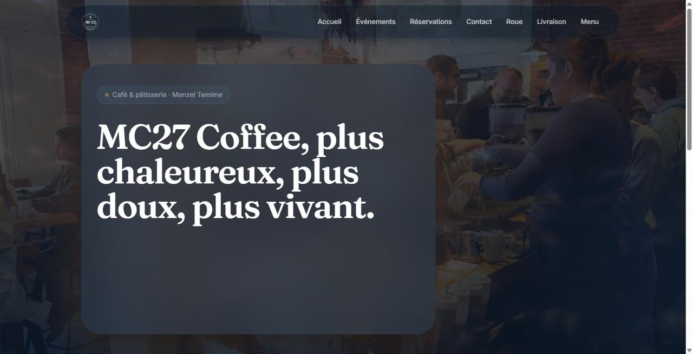
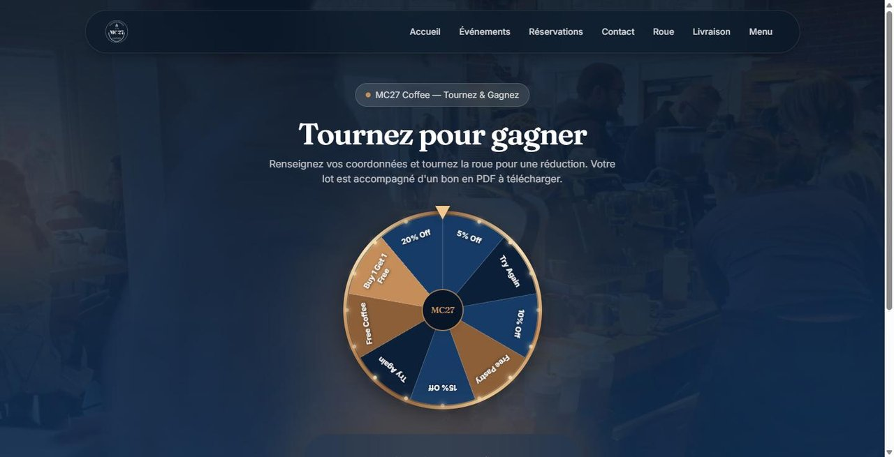
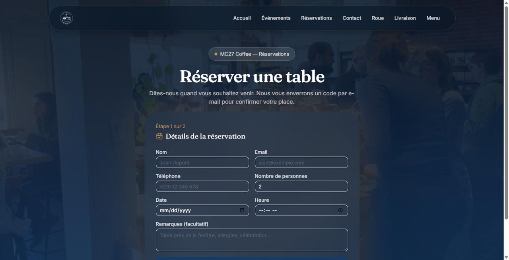

# MC27 Coffee — Café Platform


**Live:** [mc-27.vercel.app](https://mc-27.vercel.app)

The production website of MC27 Coffee, a café and pâtisserie in Menzel Temime, Tunisia: guests book tables, follow events and spin a prize wheel, and the staff run everything from an admin dashboard. I build and maintain it as the café's software developer.



| Prize wheel | Table reservation with email code |
| --- | --- |
|  |  |

## Features

**For guests**
- **Table reservations** verified by a one-time code sent by email (hashed, 10-minute expiry, 5 attempts max)
- **Events** with sign-up and attendee lists
- **Prize wheel**: one spin per guest per day, with the prize delivered as a downloadable PDF voucher with a unique code. A second wheel runs for delivery orders.
- **Contact form** and a link to the digital menu ([separate app](https://mc27m.vercel.app))

**For staff (admin dashboard)**
- Reservations, events, contact messages and wheel spins in one place
- Prize configuration for each wheel
- **Web push notifications** to staff devices when a reservation or message arrives, plus email alerts

## Engineering

| Concern | Approach |
| --- | --- |
| Data | Prisma ORM on PostgreSQL (Supabase), versioned migrations in `prisma/migrations` |
| Mutations | Next.js Server Actions with `zod` validation on every form |
| Admin auth | bcrypt-hashed password from the environment; session as a signed JWT (`jose`) in an `httpOnly` cookie, checked in a data-access layer |
| Notifications | `web-push` (VAPID) for staff devices, `nodemailer` for email |
| Documents | Vouchers generated as PDFs on the server |
| SEO | Metadata, `sitemap.ts`, `robots.ts`, site verification |

## Run locally

```bash
npm install
cp .env.example .env        # database, admin hash, SMTP, VAPID keys
npx prisma migrate deploy
npm run dev
```

| Variable | Purpose |
| --- | --- |
| `DATABASE_URL` | PostgreSQL connection string |
| `ADMIN_PASSWORD_HASH` | bcrypt hash of the admin password |
| `SESSION_SECRET` | Key used to sign admin session JWTs |
| `SMTP_HOST`, `SMTP_PORT`, `SMTP_USER`, `SMTP_PASS`, `MAIL_FROM`, `ADMIN_NOTIFY_EMAIL` | Email delivery |
| `NEXT_PUBLIC_VAPID_PUBLIC_KEY`, `VAPID_PRIVATE_KEY`, `VAPID_SUBJECT` | Web push |
| `NEXT_PUBLIC_SUPABASE_URL`, `SUPABASE_SERVICE_ROLE_KEY` | Image storage |
| `NEXT_PUBLIC_SITE_URL`, `MENU_APP_URL`, `GOOGLE_SITE_VERIFICATION` | Site configuration |

## Author

**Moktada Zaidi** — [GitHub](https://github.com/mo9tada) · [Portfolio](https://www.moktadazaidi.me)
